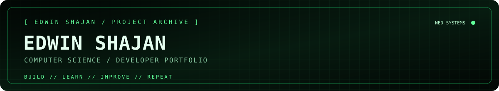

# Edwin Shajan | Developer Portfolio

<div align="center">



### Computer Science · Linux · Open Source · Web & Embedded Systems

[](https://portfolio-xi-navy-2m91yevxs3.vercel.app)
[](https://github.com/Edwinshajan2006)

</div>

A responsive, static personal portfolio presenting my background, technical interests, selected projects and professional links.

## Features

- Responsive single-page layout
- Dark and light themes with saved preference
- Project cards linking directly to their repositories
- Resume information modal with print-to-PDF support
- Mobile navigation
- LinkedIn and GitHub contact links
- Reduced-motion accessibility support

## Built with

- HTML5
- CSS3
- Vanilla JavaScript
- Lucide icons
- Google Fonts

No framework, package installation, backend, environment variables or build step is required.

## Run locally

```bash
git clone https://github.com/Edwinshajan2006/portfolio.git
cd portfolio
python3 -m http.server 8000
```

Open http://localhost:8000.

You can also open `index.html` directly in a browser.

## Deploy to Vercel

This repository is a plain static website. To deploy it:

1. Import `Edwinshajan2006/portfolio` into [Vercel](https://vercel.com/new).
2. Set **Framework Preset** to **Other**.
3. Set the **Root Directory** to `./`.
4. Leave **Build Command** empty.
5. Set **Output Directory** to `.`.
6. Click **Deploy**.

Every push to the connected `main` branch will trigger a new deployment.

There is intentionally no `vercel.json`, package manager or build configuration to maintain. Vercel can serve the HTML, CSS, JavaScript and assets directly.

## Project structure

```text
portfolio/
├── index.html       # Portfolio content and page structure
├── styles.css       # Responsive layout and themes
├── script.js        # Theme, navigation, resume modal and scrollspy
├── assets/
│   ├── avatar.png
│   ├── smart_fridge.png
│   └── event_mgmt.png
├── profile-banner.svg
└── README.md
```

## Featured projects

- [NED-OS](https://github.com/Edwinshajan2006/Ned-OS) · Personal Linux environment
- [KTUNOTES.LIVE](https://github.com/Edwinshajan2006/ktunotes.live) · Student resource platform
- [SMS Spam Detection](https://github.com/Edwinshajan2006/SPAM-DETECTION) · NLP and machine learning
- [Smart Fridge Manager](https://github.com/Edwinshajan2006/SMART-FRIDGE-MANAGER) · Food inventory web app

## Contact

- [GitHub](https://github.com/Edwinshajan2006)
- [LinkedIn](https://www.linkedin.com/in/edwin-shajan-53374231a/)

---

<div align="center">

**Designed and built by Edwin Shajan**

</div>
